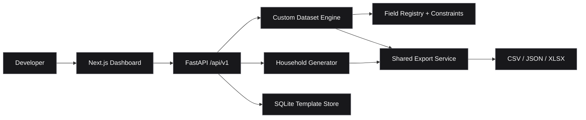

<div align="center">


### Developer tools. One workspace.

**Synthetic data · Reusable templates · Reliable testing**

[](#features)
[](https://nextjs.org/)
[](https://www.typescriptlang.org/)
[](https://fastapi.tiangolo.com/)
[](https://python.org/)

[Overview](#overview) · [Features](#features) · [Architecture](#architecture) · [Quick Start](#quick-start) · [Roadmap](#roadmap)

</div>

---

## Overview

**ALZA DevKit** is a private developer operations workspace for generating synthetic test data and building reusable engineering utilities. Version **0.2.0** introduces the **Custom Dataset Builder** alongside the existing household generator.

## Features

| Module | Status | Capabilities |
| :-- | :-- | :-- |
| **Household Generator** | Available | Seeded synthetic records, paginated preview, 1–1,000 rows |
| **Custom Dataset Builder** | Available | Configurable fields, typed constraints, three computed operations |
| **Template Library** | Available | Create, edit, duplicate, delete, import/export, SQLite persistence |
| **Export Engine** | Available | CSV, JSON, Excel; spreadsheet formula protection |
| Database Schema Importer | Planned | Import database structure |
| API Testing Lab | Planned | Endpoint and response testing |
| Code Auditor | Planned | Code quality analysis |
| Deployment Monitor | Planned | Application health monitoring |

## Architecture



```text
alza-devkit/
├── apps/
│   ├── web/          # Next.js, TypeScript, Tailwind, shadcn/ui
│   └── api/          # FastAPI, Faker, SQLite, OpenPyXL, Pytest
├── docs/             # Implementation guides
├── scripts/          # Browser verification scripts
├── infra/            # Infrastructure workspace
└── storage/          # Local workspace data
```

## Quick Start

**Requirements:** Node.js, npm, Python 3.12+, and [uv](https://docs.astral.sh/uv/).

```powershell
git clone https://github.com/SPATIBAIII/alza-devkit.git
cd alza-devkit
```

**Terminal 1 — Backend**

```powershell
cd apps/api
uv sync
uv run uvicorn app.main:app --host 127.0.0.1 --port 8000
```

**Terminal 2 — Frontend**

```powershell
cd apps/web
npm ci
npm run dev -- --hostname 127.0.0.1
```

| Service | Address |
| :-- | :-- |
| Dashboard | http://localhost:3000 |
| API docs | http://127.0.0.1:8000/docs |
| Health check | http://127.0.0.1:8000/api/v1/health |

Copy `apps/web/.env.example` to `apps/web/.env.local` if you need to configure `NEXT_PUBLIC_API_BASE_URL`.

## Generate a Dataset

Open **Mock Data Factory** and select either **Household Dataset** or **Custom Dataset**. The custom builder lets you configure fields, validate constraints, generate records, preview results, and export files. Save custom templates to reuse them after restarting the application.

The **Student Enrollment** preset is a convenient starting example.

### API examples

```http
GET /api/v1/data-factory/households?count=5&seed=42
POST /api/v1/data-factory/custom/validate
POST /api/v1/data-factory/custom/generate
POST /api/v1/data-factory/custom/export?format=xlsx
GET /api/v1/data-factory/templates
```

See [Custom Dataset Builder documentation](docs/custom-dataset-builder.md) for request bodies and all endpoints.

## Verification

```powershell
# apps/api
uv run python -m pytest -q

# apps/web
npx tsc --noEmit
npm run lint
npm run build
```

**127 backend tests passed** during the v0.2.0 implementation, along with TypeScript, ESLint, production build, both browser suites, and template persistence after API restart. These are historical results, not a live CI badge.

## Roadmap

- [x] Dashboard and FastAPI backend
- [x] Household data generator
- [x] Custom Dataset Builder
- [x] SQLite template library and JSON import/export
- [x] CSV / JSON / Excel downloads
- [ ] Database Schema Importer
- [ ] API Testing Lab
- [ ] Code Auditor
- [ ] Deployment Monitor

## Documentation

- [Custom Dataset Builder](docs/custom-dataset-builder.md)
- [Mock Data Factory](docs/mock-data-factory.md)
- [Backend Guide](apps/api/README.md)

## Security & Limits

ALZA DevKit is an **internal localhost-oriented MVP**, without authentication or authorization. Do not expose it publicly without hardening. Generate synthetic data only and do not commit secrets, real personal information, or local SQLite databases.

Current limits: **1,000 rows**, **50 fields**, **three computed operations**, and local SQLite storage.

## License

No license is specified. All rights reserved unless a license is added.

---

<div align="center">

<sub>ENGINEERED FOR BETTER DEVELOPMENT WORKFLOWS</sub>

**ALZA DEVKIT** · Build / Test / Ship

</div>
