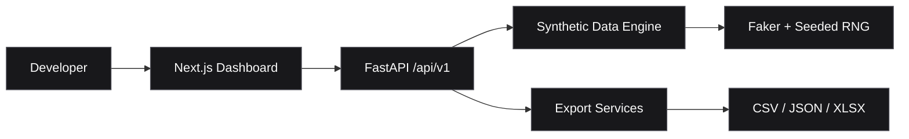

<div align="center">


### A private developer operations workspace.

**Generate test data. Validate workflows. Build with confidence.**

[](https://nextjs.org/)
[](https://www.typescriptlang.org/)
[](https://fastapi.tiangolo.com/)
[](https://tailwindcss.com/)

[Overview](#overview) · [Features](#features) · [Architecture](#architecture) · [Quick Start](#quick-start) · [Roadmap](#roadmap)

</div>

---

## Overview

**ALZA DevKit** is an internal developer toolkit for building, testing, and maintaining software projects from a single workspace. It brings repeatable development utilities into a clean web interface backed by a modular Python API.

> **Current release:** Mock Data Factory MVP. Other modules shown in the roadmap are planned, not shipped.

## Features

<table>
<tr><td width="50%" valign="top">

### 01 / Mock Data Factory
**Available**

- Synthetic household records with Filipino-style Faker names
- Configurable row count (1–1,000)
- Reproducible results with a random seed
- Paginated dataset preview
- CSV, JSON, and Excel exports
- Input validation and spreadsheet-formula protection

</td><td width="50%" valign="top">

### 02 / Custom Dataset Builder
**Planned**

- Custom fields and generation rules
- Reusable schema templates
- Multiple dataset presets
- Typed constraints and computed fields

</td></tr>
<tr><td width="50%" valign="top">

### 03 / API Testing Lab
**Planned**

- Endpoint requests and response inspection
- Reusable API test collections
- Environment-aware testing

</td><td width="50%" valign="top">

### 04 / Developer Operations
**Planned**

- Database inspection
- Code quality auditing
- Deployment health monitoring
- Engineering reports

</td></tr>
</table>

## Architecture



```text
alza-devkit/
├── apps/
│   ├── web/          # Next.js, TypeScript, Tailwind, shadcn/ui
│   └── api/          # FastAPI, Faker, OpenPyXL, Pytest
├── docs/             # Engineering and setup guides
├── scripts/          # Verification utilities
├── infra/            # Infrastructure workspace
└── storage/          # Local workspace data
```

## Quick Start

**Requirements:** Node.js and npm, Python 3.12+, and [uv](https://docs.astral.sh/uv/).

```powershell
git clone https://github.com/SPATIBAIII/alza-devkit.git
cd alza-devkit
```

**Terminal 1 — API**

```powershell
cd apps/api
uv sync
uv run uvicorn app.main:app --reload --host 127.0.0.1 --port 8000
```

**Terminal 2 — Web**

```powershell
cd apps/web
npm ci
npm run dev
```

| Service | Local address |
| :-- | :-- |
| Dashboard | http://localhost:3000 |
| API | http://127.0.0.1:8000 |
| Swagger UI | http://127.0.0.1:8000/docs |
| Health check | http://127.0.0.1:8000/api/v1/health |

If needed, copy `apps/web/.env.example` to `apps/web/.env.local` and configure `NEXT_PUBLIC_API_BASE_URL`. Restart the web server after changing it.

## Using Mock Data Factory

1. Open **Mock Data Factory** in the dashboard sidebar.
2. Select **Household Dataset**.
3. Enter the number of records and an optional seed.
4. Click **Generate Dataset**.
5. Preview records and download **CSV**, **JSON**, or **Excel**.

The generator creates **synthetic records only**. Income categories are illustrative, not official classifications. No real citizen data is required.

### API example

```http
GET /api/v1/data-factory/households?count=5&seed=42
```

Export the same configuration:

```http
GET /api/v1/data-factory/households/export?count=5&seed=42&format=xlsx
```

Supported export formats: `csv`, `json`, `xlsx`.

## Quality Checks

```powershell
# Backend
cd apps/api
uv run python -m pytest

# Frontend (in another terminal)
cd apps/web
npx tsc --noEmit
npm run lint
npm run build
```

The Mock Data Factory implementation guide reports **45 passing backend tests**, along with successful TypeScript, ESLint, production build, and browser checks at the time of its verification. These are historical results, **not a live CI status badge**.

## Roadmap

- [x] Next.js dashboard and navigation
- [x] FastAPI backend and health endpoint
- [x] Mock Data Factory — household preset
- [x] Dataset preview and CSV / JSON / XLSX exports
- [ ] Custom Dataset Builder and saved templates
- [ ] Database Schema Importer
- [ ] API Testing Lab
- [ ] Code Auditor
- [ ] Deployment Monitor

## Documentation

- [Mock Data Factory — implementation and verification](docs/mock-data-factory.md)
- [FastAPI application guide](apps/api/README.md)

## Security

ALZA DevKit is designed as a **private internal development tool**, not a publicly exposed service. Do not commit secrets, environment files, real personal data, or generated datasets containing sensitive information. Add authentication, authorization, and deployment hardening before exposing it beyond a trusted local environment.

## License

No license has been specified for this repository. All rights are reserved unless a license is added.

---

<div align="center">

<sub>ENGINEERED FOR BETTER DEVELOPMENT WORKFLOWS</sub>

**ALZA DEVKIT** · Internal developer tooling

</div>
